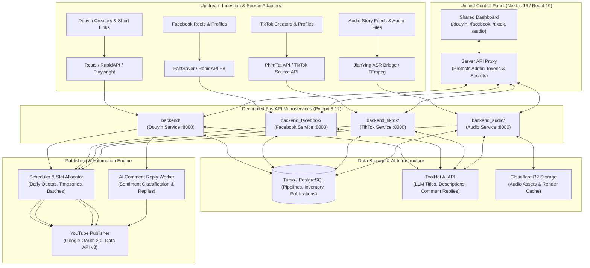

# ToolNet Publishing Platform

> Multi-Platform Video Automation & AI-Powered Publishing

[](https://github.com/LETAN-Media/douyin-youtube/actions/workflows/ci.yml)
[](https://www.python.org/)
[](https://nodejs.org/)
[](https://nextjs.org/)
[](https://www.typescriptlang.org/)
[](#license)

---

## 1. Project Overview

**ToolNet Publishing Platform** is an enterprise-grade, multi-platform video automation and AI-powered publishing ecosystem. It ingests viral and long-form multimedia from diverse upstream networks (**Douyin**, **Facebook Reels**, **TikTok**, and **Audio Story** feeds), processes media pipelines through dedicated microservices, generates platform-optimized titles, descriptions, and hashtags via the **ToolNet AI** engine, and publishes to **YouTube Shorts** and **YouTube Videos** according to channel-specific schedules and quotas.

The platform is organized as a modular monorepo comprising four decoupled FastAPI backend microservices and a single unified Next.js 16 control panel, designed for high availability, multi-tenant workspace isolation, and zero-downtime containerized deployments.

---

## 2. Key Features

- **Multi-Pipeline Orchestration**: Create, manage, and inspect independent pipelines for Douyin, Facebook, TikTok, and Audio content streams.
- **Upstream Source Ingestion & Scanning**:
  - Profile URL and short-link normalization (e.g. `@username`, `v.douyin.com`, `vt.tiktok.com`, `facebook.com/reel`).
  - Quota-guarded inventory discovery via RapidAPI providers with automatic failover pools.
  - Headless browser scanning (Playwright Chromium) and self-hosted fallback API resolvers.
- **AI-Powered Metadata Generation**:
  - Contextual YouTube titles, descriptions, and tag sets generated via the **ToolNet AI API** (`groq/qwen/qwen3.8-27b` and fine-tuned models).
  - Multi-level content relevance filtering (Match, Borderline, Mismatch) to safeguard channel niche integrity.
  - Granular pipeline-level prompt customisation (System Prompt, Title Rules, Description Template, Hashtag Count, and Language).
- **Automated & Manual Publishing Modes**:
  - **Auto Mode**: Background worker polls inventory, evaluates content DNA, requests AI metadata, and uploads to scheduled YouTube slots.
  - **Manual Mode**: Paste single video link, download via high-speed resolver, inspect AI preview, edit metadata in real-time, and publish immediately.
- **YouTube OAuth 2.0 & Multi-Destination Routing**:
  - Multi-destination support per pipeline with channel avatar and status synchronization.
  - CSRF-hardened state validation, automatic token refreshing, and scope reconciliation.
  - YouTube Shorts 4-per-day quota guardrail with timezone-aware slot allocation.
- **AI Comment Reply Engine (Douyin)**:
  - Separate background worker polling newly published YouTube comments.
  - Sentiment and category classification (positive, inquiry, neutral, critical, spam, sensitive).
  - Independent system prompt from video metadata, supporting Draft/Review and Automated publishing modes.
- **Audio Story Video Synthesis (Audio)**:
  - Automatic audio extraction and AAC stream-copy/transcoding via FFmpeg.
  - Automated ASR transcription and subtitle overlay using the JianYing Node.js bridge.
  - Dynamic loop rendering with background asset cycling and MOV template overlays.
  - Cloudflare R2 object storage integration for media asset distribution.
- **Real-Time Pipeline Flow State**: 6-node live orbit visualization across Sources, Inventory, AI Metadata, Scheduler, Publisher, and YouTube Destinations.

---

## 3. Supported Platforms

| Platform | Ingestion Path | Processing Highlights | Publishing Target | Status |
| :--- | :--- | :--- | :--- | :--- |
| **Douyin** | Profile scans, short links (`v.douyin.com`), Rcuts API, RapidAPI JustOne v3 pool | AI Content Match (3-tier), Content DNA, RapidAPI monthly budget guard, Playwright | YouTube Shorts, YouTube Video, AI Comment Replies | **Production Ready** |
| **Facebook Reels** | Profile & page scraping, RapidAPI Facebook scraper, FastSaver | Video deduplication, SHA-256 fingerprinting, time-slot batch scheduler | YouTube Shorts, YouTube Video | **Production Ready** |
| **TikTok** | Profile URLs (`@username`), TikTok Source API, PhimTat API resolver | Video inventory deduplication, pipeline-level AI settings, 6-node flow state | YouTube Shorts, YouTube Video | **Production Ready** |
| **Audio Stories** | Audio files, Facebook audio story feeds, Snapvideo | JianYing ASR bridge subtitles, FFmpeg loop rendering, Cloudflare R2 storage | YouTube Video (Long-form) | **Production Ready** |

---

## 4. System Architecture

The platform follows a decoupled microservice architecture where backends share no operational dependencies and communicate with the frontend through a protected server-side proxy layer:



---

## 5. Technology Stack

### Backend Services
- **Framework**: FastAPI (Python 3.12) with Uvicorn ASGI server
- **Database & ORM**: SQLAlchemy 2.0, Turso LibSQL (`libsql-client`, `sqlalchemy-libsql`), Psycopg 3 (PostgreSQL)
- **Configuration & Validation**: Pydantic v2 & Pydantic-Settings
- **Video & Audio Processing**: FFmpeg, FFprobe, `yt-dlp`
- **Headless Browser**: Playwright (Chromium)
- **Subtitles & ASR**: JianYing ASR bridge (`transcribe.mjs`, Node.js)
- **Object Storage**: Amazon S3 / Cloudflare R2 SDK (`boto3`)
- **External Integration**: Google API Python Client, Google Auth OAuthlib, HTTPX

### Frontend Dashboard
- **Framework**: Next.js 16.3 (App Router)
- **UI Library**: React 19
- **Language**: TypeScript 5.7
- **Styling**: Tailwind CSS v4
- **Linting & Type Safety**: ESLint 9, `tsc --noEmit`

### DevOps & Infrastructure
- **Containerization**: Docker multi-stage builds (`python:3.12-slim`)
- **CI/CD**: GitHub Actions (Path filtering via `dorny/paths-filter@v3`, pip/npm caching, parallel testing, Docker validation)
- **Hosting Targets**: Northflank (Microservices), Vercel (Next.js Dashboard)

---

## 6. Repository Structure

```
douyin-youtube/
├── .github/
│   └── workflows/
│       └── ci.yml                 # Modular CI workflow with path-filtering
├── backend/                       # Douyin -> YouTube automation service
│   ├── app/
│   │   ├── main.py                # Core FastAPI application & routes
│   │   ├── ai_metadata.py         # AI titling, description & hashtag generator
│   │   ├── ai_comment_reply.py    # Independent comment reply worker
│   │   ├── channel_dna.py         # Video fingerprinting & niche evaluation
│   │   ├── douyin_import.py       # RapidAPI pool & inventory pagination
│   │   ├── scheduler.py           # Slot allocator & daily limit rules
│   │   ├── youtube.py             # YouTube OAuth 2.0 & publisher
│   │   └── models.py              # SQLAlchemy database models
│   ├── tests/                     # 355 unit & regression tests
│   ├── Dockerfile                 # Playwright & FFmpeg production container
│   ├── requirements.txt           # Python dependencies
│   └── .env.example               # Backend environment template
├── backend_facebook/              # Facebook Reels -> YouTube automation service
│   ├── app/
│   │   ├── routes/                # Facebook, AI, Flow, Schedule, YouTube routes
│   │   ├── services/              # Ingestion, Media probe, RapidAPI, Scheduler
│   │   └── db/                    # Turso LibSQL repositories
│   ├── tests/                     # 404 unit & integration tests
│   ├── Dockerfile                 # Production Dockerfile
│   └── requirements.txt
├── backend_tiktok/                # TikTok -> YouTube automation service
│   ├── app/
│   │   ├── routes/                # Pipelines, Sources, Inventory, Manual, AI
│   │   ├── services/              # TikTok API, PhimTat resolver, Live flow state
│   │   └── db/                    # Turso LibSQL repositories
│   ├── tests/                     # 63 unit & regression tests
│   ├── Dockerfile                 # Production Dockerfile
│   └── requirements.txt
├── backend_audio/                 # Audio Stories -> YouTube automation service
│   ├── app/
│   │   ├── routes/                # Audio pipelines, Media, Jobs, Scheduler
│   │   ├── services/              # FFmpeg loop renderer, ASR, Cloudflare R2
│   │   └── assets/jianying/       # Node.js ASR subtitle bridge
│   ├── tests/                     # 102 unit & regression tests
│   ├── Dockerfile                 # Node.js + Python + FFmpeg container
│   └── requirements.txt
├── dashboard/                     # Unified Next.js 16 Control Panel
│   ├── app/
│   │   ├── (overview)/            # Multi-service dashboard home
│   │   ├── channels/              # Douyin channel management
│   │   ├── facebook/              # Facebook Reels pipelines & flow orbit
│   │   ├── tiktok/                # TikTok pipelines, sources & AI settings
│   │   ├── audio/                 # Audio stories & loop render pipelines
│   │   └── api/                   # Server-side API proxy routes
│   ├── lib/                       # API clients & session handling
│   ├── package.json               # Next.js 16 dependencies
│   └── eslint.config.mjs          # Linting rules
├── CONTRIBUTING.md                # Development & contribution guidelines
├── SECURITY.md                    # Vulnerability reporting & security policy
└── README.md                      # Platform documentation
```

---

## 7. Getting Started

### Prerequisites
- **Python**: `3.12+`
- **Node.js**: `22.x LTS` and `npm 10.x+`
- **FFmpeg**: Installed locally for video/audio processing tests
- **Git**

### 1. Clone the Repository
```bash
git clone https://github.com/LETAN-Media/douyin-youtube.git
cd douyin-youtube
```

### 2. Setting Up a Backend (e.g. TikTok Service)
```bash
cd backend_tiktok
python3 -m venv .venv
source .venv/bin/activate
pip install --upgrade pip
pip install -r requirements.txt pytest pytest-asyncio

# Configure environment
cp .env.example .env
# Edit .env with your configuration

# Run unit tests
pytest tests/

# Launch development server
uvicorn app.main:app --reload --port 8000
```

### 3. Setting Up the Douyin Backend
```bash
cd backend
python3 -m venv .venv
source .venv/bin/activate
pip install --upgrade pip
pip install -r requirements.txt pytest pytest-asyncio
python -m playwright install chromium

# Run unit tests (uses isolated SQLite schema)
DATABASE_PROVIDER=sqlite DATABASE_URL=sqlite:////tmp/dev_douyin.db ADMIN_TOKEN=dev-token WORKER_ENABLED=false PYTHONPATH=. pytest tests/

# Launch development server
uvicorn app.main:app --reload --port 8000
```

### 4. Setting Up the Dashboard
```bash
cd dashboard
cp .env.example .env.local
# Set DOUYIN_API_URL, FACEBOOK_API_URL, TIKTOK_API_URL, AUDIO_API_URL, and DASHBOARD_SECRET

# Install dependencies and build
npm ci
npm run lint
npm run build

# Start development server
npm run dev
# Open http://localhost:3000 in your browser
```

---

## 8. Environment Configuration

All microservices use environment-driven configuration. Real secrets and credentials should **never** be committed to source control.

### Dashboard Configuration (`dashboard/.env.local`)
```env
# Server-side backend API URLs (Never use NEXT_PUBLIC_ prefix for tokens)
DOUYIN_API_URL=http://localhost:8000
DOUYIN_ADMIN_TOKEN=your_secure_admin_token

FACEBOOK_API_URL=http://localhost:8001
FACEBOOK_ADMIN_TOKEN=your_secure_admin_token

TIKTOK_API_URL=http://localhost:8002
TIKTOK_ADMIN_TOKEN=your_secure_admin_token

AUDIO_API_URL=http://localhost:8080
AUDIO_API_TOKEN=your_secure_admin_token

# Dashboard session authentication secret
DASHBOARD_SECRET=your_super_secret_login_password
```

### Backend Microservice Common Environment
```env
PORT=8000
ADMIN_TOKEN=your_secure_admin_token
CORS_ORIGINS=*

# Turso Database / SQLite connection
TURSO_DATABASE_URL=libsql://your-database.turso.io
TURSO_TOKEN=your_turso_auth_token

# Google YouTube OAuth (Data API v3)
GOOGLE_CLIENT_ID=your_google_client_id.apps.googleusercontent.com
GOOGLE_CLIENT_SECRET=your_google_client_secret
PUBLIC_BASE_URL=https://your-api-domain.com

# ToolNet AI Integration
TOOLNET_BASE_URL=https://api.toolnet.tech/v1
TOOLNET_API_KEY=your_toolnet_ai_api_key
TOOLNET_MODEL=groq/qwen/qwen3.8-27b
TOOLNET_AI_ENABLED=true
```

---

## 9. Backend Services Overview

### 1. Douyin Service (`backend/`)
- Ingests creators and videos from Douyin via JustOne RapidAPI v3 with automated primary and multi-slot fallback rotation.
- Implements monthly request quota guardrails to eliminate over-budget exceptions.
- Employs Playwright Chromium for automated creator inventory scans.
- Features dual-mode AI processing: video metadata generation and independent sentiment-based comment replies.

### 2. Facebook Reels Service (`backend_facebook/`)
- Ingests viral short-form Reels from public Facebook creators and pages.
- Integrates RapidAPI Facebook scraper and FastSaver fallback resolvers.
- Implements SHA-256 binary deduplication to eliminate cross-destination reposting.
- Batched time-slot allocator coordinating releases into YouTube Shorts slots.

### 3. TikTok Service (`backend_tiktok/`)
- Handles TikTok creator profiles, video inventories, and short-link redirects.
- Standardized upstream source resolver using the PhimTat media API with direct CDN resolution.
- Granular per-pipeline AI prompt customisation (System, Title, Description, Hashtag counts).
- Real-time 6-node flow state visualization API.

### 4. Audio Stories Service (`backend_audio/`)
- Long-form audio stories publishing platform with automated video assembly.
- Automated ASR caption generation via the JianYing Node.js bridge.
- High-performance FFmpeg rendering engine with template overlays and background asset rotation.
- Cloudflare R2 asset storage for audio tracks and rendered video artifacts.

---

## 10. Dashboard

The frontend control panel provides a responsive, desktop- and mobile-optimized management interface:

- **Unified Navigation**: Switch effortlessly between Douyin Channels, Facebook Pipelines, TikTok Pipelines, and Audio Stories.
- **Pipeline Live Orbit Diagram**: Lightweight visual orbit diagram displaying real-time metrics across all 6 processing stages (Sources, Inventory, AI, Scheduler, Publisher, Destinations).
- **Manual Publishing Workbench**: Real-time URL resolver, dynamic AI metadata preview, manual override controls, and immediate publish triggers.
- **Pipeline AI Settings**: Custom prompt editors, language targets, model selectors, and test-run previewers without publishing.
- **Destination Manager**: Connect YouTube channels with one click via Google OAuth 2.0, verify channel avatars, set upload limits, and select default channels.

---

## 11. AI Metadata & Automation

The platform integrates the **ToolNet AI Engine** across all publishing pipelines:

1. **Context-Aware Titles**: Analyzes caption, creator context, and audio transcripts to formulate high-CTR YouTube titles tailored to channel niche.
2. **SEO Descriptions**: Generates clean, informative summaries while stripping raw platform noise and watermarks.
3. **Optimized Hashtags**: Enforces exact hashtag counts, bans forbidden channel tags, and injects channel-fixed tags alongside adaptive trend tags.
4. **Three-Tier Relevance Gate**:
   - `MATCH`: Content completely aligns with channel niche; proceeds to automated queue.
   - `BORDERLINE`: Content plausibly relates to audience; flags advisory but allows scheduling.
   - `MISMATCH`: Content conflicts with channel brand; safely rejected and tagged as `content_mismatch`.

---

## 12. YouTube Integration

- **Google OAuth 2.0 Authorization**: Implements strict CSRF `state` tracking, token expiry detection, and one-click reconnection.
- **Upload Quota Management**: Enforces the YouTube Shorts 4-per-day standard limit per channel to maintain algorithmic reach and avoid spam flags.
- **Timezone-Aware Scheduling**: Automatic local time to UTC conversion, allowing creators to target peak viewer hours across global regions.
- **Comment Reply Automation**: Scans published videos, analyzes audience comments, and posts threaded replies (`comments.insert` via `parentId`).

---

## 13. Database Architecture

The platform supports both **Turso LibSQL** (edge-replicated SQLite) and **PostgreSQL**:

- `pipelines`: Pipeline definitions, platform type, slug, and status.
- `pipeline_ai_settings`: Pipeline-isolated system prompts, title prompts, and AI model parameters.
- `sources`: Tracked creator sources, profile URLs, inventory counts, and sync cursors.
- `videos` / `inventory`: Normalized raw video records, duration, thumbnails, and deduplication hashes.
- `destinations`: Connected YouTube channels, OAuth credentials, daily limits, and timezone preferences.
- `publications`: Publishing lifecycle records (`queued`, `downloading`, `processing`, `uploading`, `published`, `failed`).
- `video_jobs`: Asynchronous execution state, retry attempts, progress percentages, and error diagnostics.

---

## 14. Docker & Deployment

All services feature production-optimized multi-stage Dockerfiles.

### Local Container Build Validation
```bash
# Validate Douyin service build
docker build -t toolnet-douyin:test -f backend/Dockerfile backend

# Validate Facebook service build
docker build -t toolnet-facebook:test -f backend_facebook/Dockerfile backend_facebook

# Validate TikTok service build
docker build -t toolnet-tiktok:test -f backend_tiktok/Dockerfile backend_tiktok

# Validate Audio service build
docker build -t toolnet-audio:test -f backend_audio/Dockerfile backend_audio
```

### Production Deployment
- **Microservices**: Deployed as independent compute containers on **Northflank** with automatic restart policies and resource allocation.
- **Dashboard**: Deployed on **Vercel** with global CDN edge delivery and serverless proxy routes.

---

## 15. Continuous Integration (CI/CD)

The repository is equipped with a GitHub Actions CI workflow ([`.github/workflows/ci.yml`](.github/workflows/ci.yml)):

- **Intelligent Path Filtering**: Detects modified files via `dorny/paths-filter@v3` and only executes jobs for the modified service, saving GitHub Actions minutes.
- **Parallelized Job Matrix**:
  - `douyin-tests`: 355 unit & regression tests with isolated SQLite schema.
  - `facebook-tests`: 404 tests with LibSQL test runner.
  - `tiktok-tests`: 63 tests validating URL normalization, PhimTat API, and pipeline AI settings.
  - `audio-tests`: 102 tests with FFmpeg system dependencies and ASR bridge tests.
  - `dashboard-ci`: TypeScript verification, ESLint zero-warning check, and Next.js production build.
  - `docker-validation`: Validates container image builds when Dockerfiles or requirements change.
- **Security & Efficiency**: Uses `permissions: contents: read`, dependency caching for `pip` and `npm`, and zero exposure of production secrets.

---

## 16. Security Considerations

- **Server-Side Token Isolation**: All administrative API tokens and OAuth secrets are restricted to backend environments and Next.js server runtime; client browsers never receive raw credentials.
- **OAuth State Protection**: YouTube OAuth flow validates cryptographically random, single-use `state` parameters stored in the database with strict expiration windows.
- **Tenant & Workspace Boundaries**: API queries enforce workspace-level ownership verification (`tenancy.py`) preventing Insecure Direct Object Reference (IDOR) attacks.
- **Input Sanitization**: Upstream creator URLs and redirect chains undergo strict hostname and scheme validation before triggering downstream fetch routines.

---

## 17. Troubleshooting

| Issue | Likely Cause | Solution |
| :--- | :--- | :--- |
| `admin_token: Field required` | Missing `ADMIN_TOKEN` in environment | Ensure `ADMIN_TOKEN` is exported or present in `.env`. |
| `OAuthFlowError: Invalid config` | `PUBLIC_BASE_URL` is HTTP or missing | Ensure `PUBLIC_BASE_URL` begins with `https://` and matches Google Cloud Console redirect URI. |
| `UNIQUE constraint failed` | Local test database was not unlinked | Remove stale temporary test databases: `rm -f /tmp/*test*.db`. |
| `ffmpeg: command not found` | FFmpeg not installed on host | Install FFmpeg via package manager (`sudo apt-get install -y ffmpeg` or `brew install ffmpeg`). |
| `Cannot connect to backend API` | Proxy URL mismatch in Dashboard | Verify `DOUYIN_API_URL`, `FACEBOOK_API_URL`, `TIKTOK_API_URL`, or `AUDIO_API_URL` in `dashboard/.env.local`. |

---

## 18. Roadmap

- [x] Multi-platform video pipelines (Douyin, Facebook Reels, TikTok, Audio Stories).
- [x] Automated ASR captioning with JianYing bridge integration.
- [x] Pipeline-level custom AI prompt configuration in Turso.
- [x] Automated YouTube Shorts quota guardrails (4/day limit).
- [x] Modular GitHub Actions CI with path-based execution.
- [ ] Multi-channel unified analytics dashboard (aggregate views, retention, and subscriber growth).
- [ ] Additional distribution adapters (Facebook Pages, TikTok Creator Marketplace).
- [ ] Webhook notification system for Telegram/Discord alerting on publication failures.

---

## 19. Contributing

Please review [CONTRIBUTING.md](CONTRIBUTING.md) for details on code style, branch naming conventions, test requirements, and the pull request submission process.

---

<a id="license"></a>
## 20. License

This project is currently copyrighted under **Proprietary / All Rights Reserved** by **ToolNet / LETAN Media**, pending final open-source licensing determination by the repository owner:

- **Option A (Pending Owner Approval): MIT License** — Permissive open-source license permitting use, modification, distribution, and private/commercial sublicensing with copyright notice preservation.
- **Option B (Current Default): Proprietary / All Rights Reserved** — All rights reserved by **ToolNet / LETAN Media**. No unauthorized duplication, distribution, or commercial exploitation is permitted without explicit written authorization.

Third-party libraries and tools (FastAPI, Next.js, React, yt-dlp, FFmpeg, etc.) remain subject to their respective open-source licenses.

---

## 21. Maintainer

Maintained by **ToolNet / LETAN Media**. For technical inquiries, operational support, or deployment coordination, please utilize the internal repository issue tracker.
